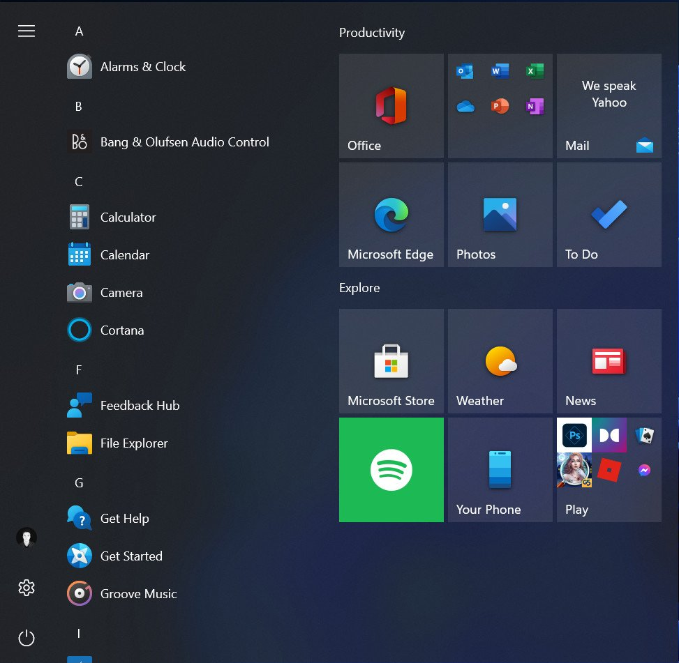

# Aero three-column Whisker Menu

This fork turns Whisker Menu into a fixed three-column launcher inspired by the
Windows 10 / Aero start menu. The upstream plugin is untouched in the initial
commit; the changes are limited to the panel plugin sources, a Podman build
recipe, and a user-local installer.



## Layout

```
+-----------+---------------------------+-------------------------+
| strip     | All Applications          | pinned favorites        |
| 77 px     | 409 px, scrollable        | remainder, unchanged    |
|           | grouped by first letter   | icon grid               |
+-----------+---------------------------+-------------------------+
```

* **Left strip (77 px)** is bottom-anchored. Top to bottom:
  **Videos**, **Music**, **Documents**, **Settings**, **Power**.
  The first three open the matching XDG user directory; the last two re-use the
  existing Whisker command buttons.
* **Middle column (409 px)** is a `GtkListBox` inside a `GtkScrolledWindow`.
  Every visible menu entry is grouped under a bold letter header (`#`, `A`,
  `B`, ...), using the plain display name rather than the markup/direction
  text. Clicking a row adds it to Recent, closes the menu, and launches it.
  Rows are spaced 20 px apart by default; the gap is configurable (below).
* **Right column** is the stock pinned-favorites view, filling the remaining
  width. It is kept as-is.

The old title/profile row, search entry, category sidebar and horizontal
category row are hidden; the menu is keyboard-driven from the application
list. Backgrounds are drawn by the plugin, not by the theme.

## Background darkness

The old percentage `/menu-opacity` setting is not used by this layout. It is
replaced by a double `/background-alpha` property:

* `0.0` = completely transparent
* `1.0` = completely opaque black
* default and current value = **0.8**

```sh
# current plugin instance (check the plugin id first if yours is not 11)
xfconf-query -c xfce4-panel -p /plugins/plugin-11/background-alpha -t double -s 0.8

# create it if the property is missing
xfconf-query -c xfce4-panel -p /plugins/plugin-11/background-alpha -n -t double -s 0.8
```

The settings dialog's "Background opacity" slider edits the same property.
Text is forced to `#ffffff` with an application-priority CSS provider, so it
stays readable on the dark background regardless of the GTK theme.

## Application row spacing

The gap between application rows is a separate integer property, in pixels:

```sh
# current plugin instance (20 px default; range 0-100)
xfconf-query -c xfce4-panel -p /plugins/plugin-11/app-row-spacing -t int -s 20

# create it if missing
xfconf-query -c xfce4-panel -p /plugins/plugin-11/app-row-spacing -n -t int -s 20
```

The settings dialog's "Application row spacing" spin button edits the same
value. Changes are applied the next time the menu opens.

## Type to filter

The menu opens with keyboard focus in the application list. Typing printable
characters filters the list immediately using the same fuzzy matcher as the
stock Whisker search page (names, generic names, comments and keywords). The
typed text is intentionally invisible in this layout for now.

* `Backspace` removes the last character.
* `Escape` returns from the letter grid, then clears a non-empty filter,
  then closes the menu on the next press.
* The filter is cleared every time the menu opens or closes.

Filtered results keep their alphabetical order and letter groups. If nothing
matches, the list shows "No applications found".

## Right-click and Pin to Start

Right-clicking an application row opens the stock application context menu
anchored to the list. Its favourite action is labelled **Pin to Start** (or
**Unpin from Start** when the application is already pinned); pinning adds the
application to the pinned grid on the right. The rest of the menu is unchanged
(desktop actions, Add to Desktop/Panel/Autostart, Edit, Hide).

## Letter picker

Clicking any letter header (`A`, `B`, `C`, ...) temporarily replaces the
application list with a grid of the letters present in the current list.
Clicking a letter switches back to the list and scrolls that letter's section
to the top. `Escape` returns to the list without changing the scroll position.

## Build

The build runs in a throwaway Podman container on top of the local
`xfce4-panel-build:4.20` image:

```sh
./build.sh          # incremental
./build.sh clean    # remove build/
./build.sh image    # force-rebuild the dependency image
```

The result is `out/libwhiskermenu.so`.

## Install (per user, no root)

```sh
./install.sh --restart
```

Xfce Panel searches the user data/library directories before the system ones,
so this installs:

* `~/.local/lib/<multiarch>/xfce4/panel/plugins/libwhiskermenu.so`
* `~/.local/share/xfce4/panel/plugins/whiskermenu.desktop`

and leaves `/usr/lib/.../libwhiskermenu.so` untouched. The system copy can be
restored at any time by removing those two user files and restarting the panel:

```sh
rm ~/.local/lib/*/xfce4/panel/plugins/libwhiskermenu.so
rm ~/.local/share/xfce4/panel/plugins/whiskermenu.desktop
xfce4-panel -r
```

A system-wide install is also possible with
`pkexec install -m 755 out/libwhiskermenu.so /usr/lib/.../libwhiskermenu.so`,
but the user-local route avoids root entirely and is the supported path here.

`xfce4-popup-whiskermenu` **toggles** the menu, so running it twice closes it.

## Notes / known limitations

* The old search box and category sidebar are hidden. The settings dialog
  still exposes the upstream layout options, but they are ignored by the fixed
  three-column layout. Search is handled by type-to-filter instead.
* The menu is still resizable with the stock edge resizers. The strip stays
  77 px and the list stays 409 px; only the favorites column grows.
* `menu_opacity` remains in the settings structure for compatibility with
  existing `.rc` files but the background draw uses `background_alpha`.
* Typing is captured by the application list and the toplevel window. If focus
  moves into the pinned grid, its own type-ahead may take over until the list
  is focused again.
